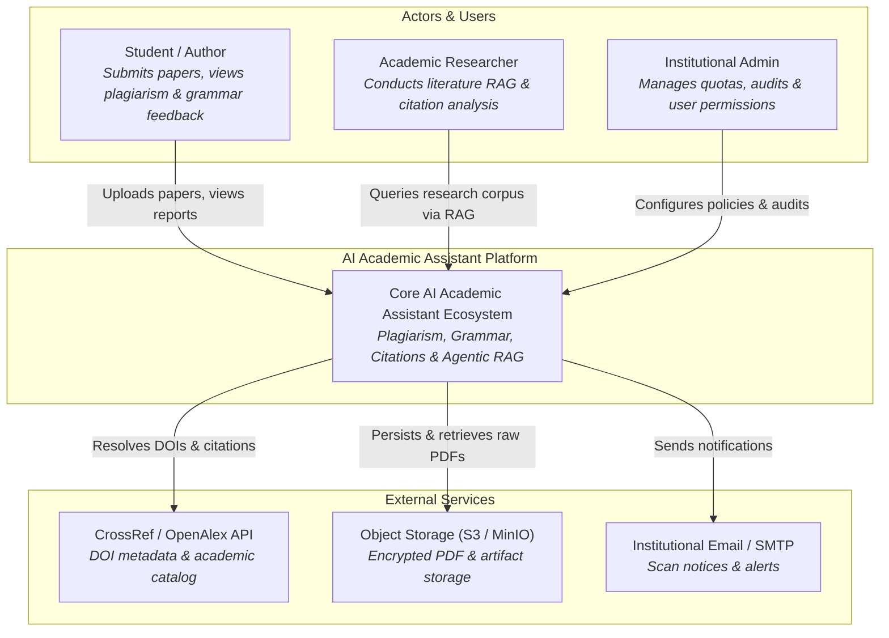
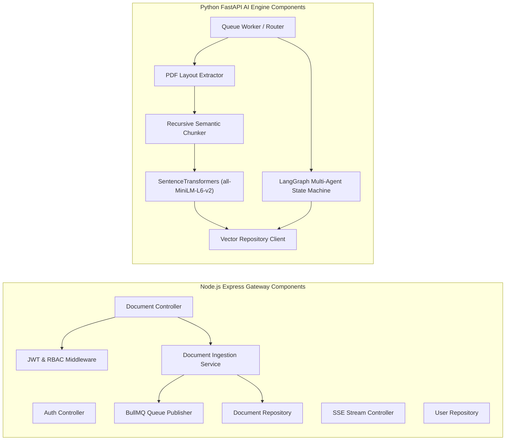
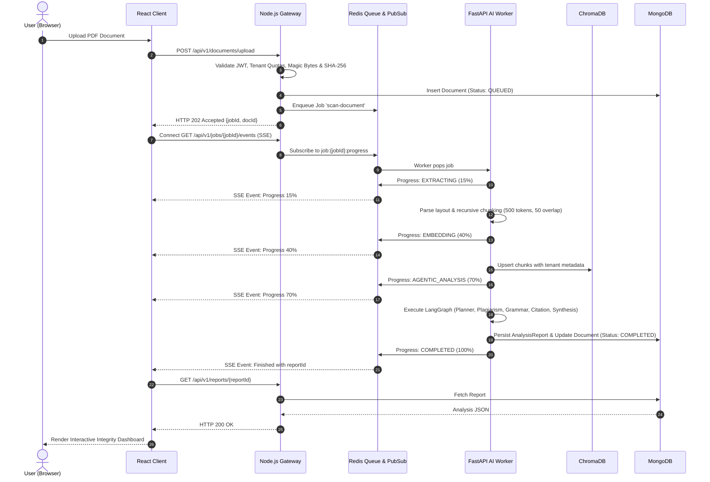
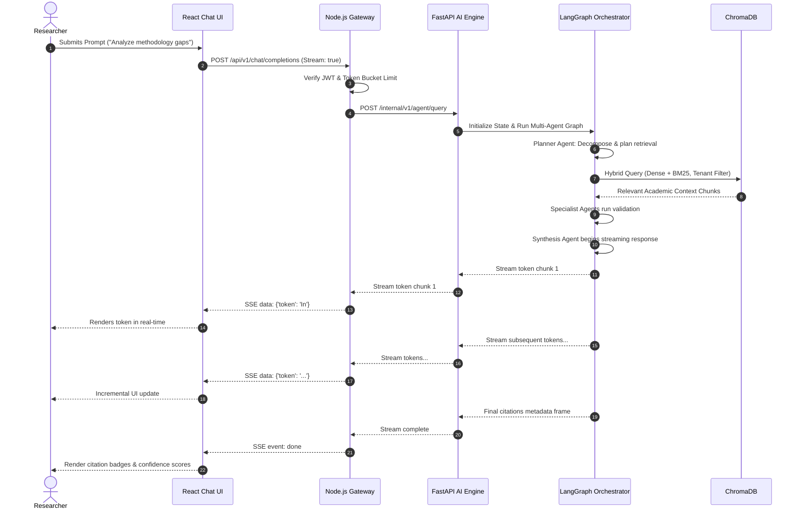

# Architectural Diagrams Reference

This directory contains the visual blueprints for the **AI Academic Assistant** platform. 

The primary source files are written in **PlantUML** (`.puml`) for C4 Model validation and CI/CD diagram generation. Below, interactive **Mermaid.js** diagrams are provided for immediate rendering in GitHub, IDEs, and browser markdown viewers.

---

## 1. System Context Diagram (C4 Level 1)
Source: [`c4_context.puml`](./c4_context.puml)



---

## 2. Container Diagram (C4 Level 2)
Source: [`c4_container.puml`](./c4_container.puml)

```mermaid
flowchart TD
    User(["User (Student / Researcher / Admin)"])

    subgraph PlatformBoundary ["AI Academic Assistant Ecosystem"]
        SPA["React 18 SPA (Vite + Tailwind)<br><i>Interactive dashboard, diffs & RAG chat</i>"]
        BFF["Node.js Express API Gateway (BFF)<br><i>Auth, JWT, Rate Limiting, Business Logic</i>"]
        Redis["Redis 7.2 Broker & Cache<br><i>BullMQ task queue & Pub/Sub events</i>"]
        FastAPI["Python FastAPI AI Microservice<br><i>LangGraph, SentenceTransformers, PyTorch</i>"]
        MongoDB[("MongoDB 7.0<br><i>Users, Documents, Reports, Audit Logs</i>")]
        ChromaDB[("ChromaDB Vector Store<br><i>384-dim Chunks, Tenant Metadata</i>")]
        Storage[("MinIO / S3 Object Store<br><i>Raw PDF Documents</i>")]
    end

    CrossRefExt["CrossRef / OpenAlex API"]

    User -->|HTTPS| SPA
    SPA -->|REST API, Uploads & SSE| BFF
    BFF -->|Reads / Writes| MongoDB
    BFF -->|Enqueues scan jobs| Redis
    BFF -->|Stores encrypted PDFs| Storage
    FastAPI -->|Consumes scan jobs| Redis
    FastAPI -->|Stores & queries vectors| ChromaDB
    FastAPI -->|Validates academic DOIs| CrossRefExt
    BFF -->|Sync Agent Queries (mTLS)| FastAPI
```

---

## 3. Component Diagram (C4 Level 3)
Source: [`c4_component.puml`](./c4_component.puml)



---

## 4. Sequence Diagram: Document Plagiarism Scan Workflow
Source: [`sequence_plagiarism_scan.puml`](./sequence_plagiarism_scan.puml)



---

## 5. Sequence Diagram: Conversational Agentic RAG Workflow
Source: [`sequence_agentic_rag.puml`](./sequence_agentic_rag.puml)


